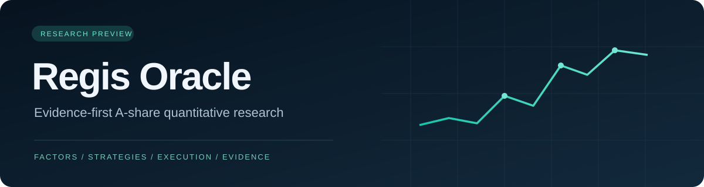

  
  
<strong>让研究假设变成可复核的证据。</strong>

  
A 股因子研究 · 策略与战法验证 · 交易约束 · 人工决策支持

  

    
    
    
    
  

  
<a href="#快速开始">快速开始</a> · <a href="docs/ARCHITECTURE.md">技术架构</a> · <a href="docs/RESEARCH_STANDARD.md">研究标准</a> · <a href="docs/ROADMAP.md">路线图</a> · <a href="CONTRIBUTING.md">参与贡献</a>

## Regis Oracle 是什么

Regis Oracle 是面向中国 A 股的开源量化研究框架，将数据检查、因子表达、策略组合、成本与成交约束、研究工作台连接在同一条研究流程中。它关注一个具体问题：**一个看起来有效的交易想法，能否在明确的数据边界、验证协议和执行条件下站得住脚？**

本项目适合研究者、Python 开发者，以及希望建立可追溯研究流程的个人投资者。研究范围聚焦 A 股；执行研究以沪深主板与创业板、短周期持仓和人工决策为主。示例使用虚构数据；软件不接入券商下单。

*Regis Oracle is an open-source, evidence-first research framework for Chinese A-shares. It combines factor research, strategy evaluation and execution constraints, with explicit boundaries between experiments and trading readiness.*

## 核心设计

| 方向 | 代码提供的能力 | 研究时需要额外证明 |
| --- | --- | --- |
| 数据与时点 | 面板结构、历史可见性检查、数据质量与来源门禁 | 覆盖、许可、退市证券、历史身份与发布时间 |
| 因子研究 | 时序/横截面算子、模板与组合、预处理、IC 与验证流程 | 经济机制、累计试验、独立时序验证 |
| 策略与战法 | 组合评估、持仓与退出规则、事件与日线研究工具 | 市场状态适用性、成本后增量、失败条件 |
| 交易约束 | A 股交易规则、整手资金约束、费用与容量模型 | 历史规则有效期、实际成交、人工延迟 |
| 研究工作台 | Flask 页面、研究 API 与证据展示的原型源码 | 接入自己的合法数据并逐入口验收 |

**当前版本：研究预览版。** 核心源码、离线示例和一组工程回归用例已开放；工作台及扩展研究工具仍在演进。工程测试不证明收益，公共版没有附带已准入实盘的策略、完整全 A 数据或在线行情服务。详情见 [版本边界](docs/PUBLIC_EDITION.md)。

## 快速开始

推荐 Python 3.12。先运行不联网、不需要行情或账户的离线示例：

~~~bash
git clone https://github.com/zidongliu11-web/regis-oracle-public.git
cd regis-oracle-public
python -m venv .venv

# Windows PowerShell
.venv\Scripts\Activate.ps1

# macOS / Linux
# source .venv/bin/activate

python -m pip install -r requirements-dev.txt
python examples/offline_factor_demo.py
python -m pytest -q
python scripts/check_public_release.py
~~~

示例用固定随机种子生成虚构面板，演示因子计算与横截面处理，输出形状、缺失值及研究状态；它不会把模拟结果登记为真实因子或交易信号。

需要查看桌面工作台源码与本地页面时，参阅 [工作台启动说明](docs/GETTING_STARTED.md#桌面工作台原型)。默认不启动后台采集、训练或前向交易任务。原型页面可能因缺少合法数据或研究登记而显示未就绪。

## 仓库导览

~~~text
factor_system/                 因子算子、验证、注册与回测组件
quantqc/                       A 股规则、费用与统计工具
mom_trading/                   桌面研究工作台原型
trade_assistant/               行情适配与人工决策支持组件
research/                      扩展研究工具与回测引擎源码
examples/                      可独立运行的离线入门示例
tests/                         公共版纳入检查的回归用例
docs/                          架构、数据约定与研究标准
.github/                       自动检查、Issue 与 PR 模板
~~~

## 从假设到证据

~~~mermaid
flowchart LR
    A["合法数据与可见时点"] --> B["质量检查"]
    B --> C["冻结假设与因子定义"]
    C --> D["有限试验与失败记录"]
    D --> E["独立时序验证"]
    E --> F["成本与执行压力检查"]
    F --> G["前向观察与人工复核"]
~~~

协议文件与代码只是流程的工具。数据不完整、交易约束未证明或前向观察不足时，候选应保持研究状态。完整标准见 [研究与验证](docs/RESEARCH_STANDARD.md)。

## 一起建设

欢迎改进数据契约、算子与统计实现、策略规则、离线测试、文档和工作台体验。

- 发现问题：[提交 Bug](https://github.com/zidongliu11-web/regis-oracle-public/issues/new?template=bug_report.yml)。
- 提出方向：[功能建议](https://github.com/zidongliu11-web/regis-oracle-public/issues/new?template=feature_request.yml) 或 [研究提案](https://github.com/zidongliu11-web/regis-oracle-public/issues/new?template=research_proposal.yml)。
- 修改代码：Fork → 建立分支 → 实际验证 → 提交 Pull Request。合并由维护者审核，详见 [贡献指南](CONTRIBUTING.md)。
- 近期重点：[路线图](docs/ROADMAP.md)；版本变动：[更新记录](CHANGELOG.md)。

维护者：[zidongliu11-web](https://github.com/zidongliu11-web)。不承诺固定响应时间、研究期限或投资回报。

## 许可

项目原创代码采用 [MIT License](LICENSE)，允许查看、修改、再分发和商业使用，并保留许可证要求的声明。第三方资产保留各自许可证，见 [第三方声明](THIRD_PARTY_NOTICES.md)。行情、公告、研报及外部服务的使用权由各自权利人和条款决定，软件许可证不授予这些数据的再分发权。

